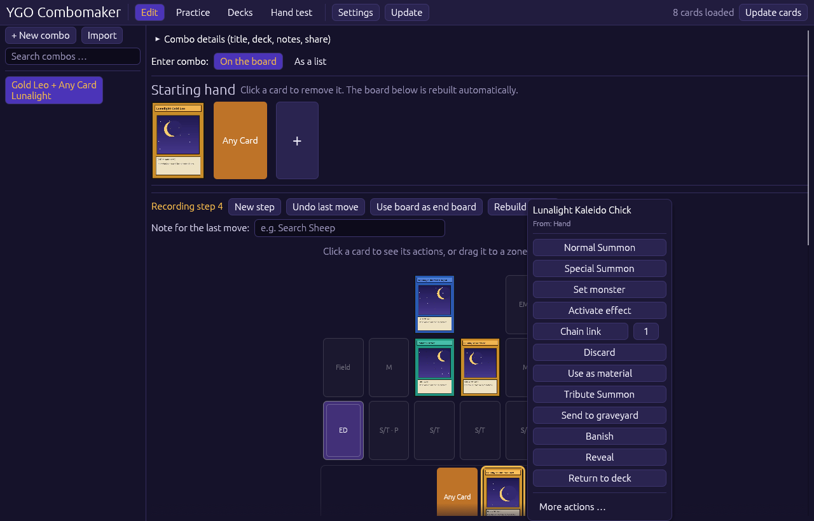
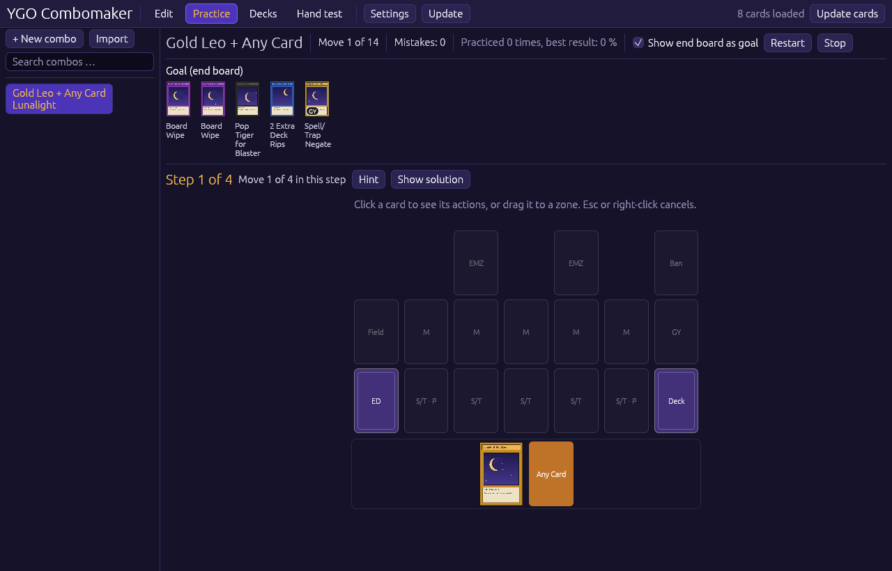
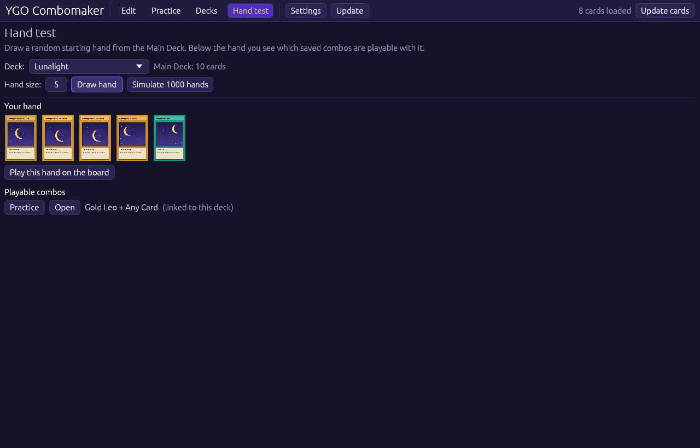
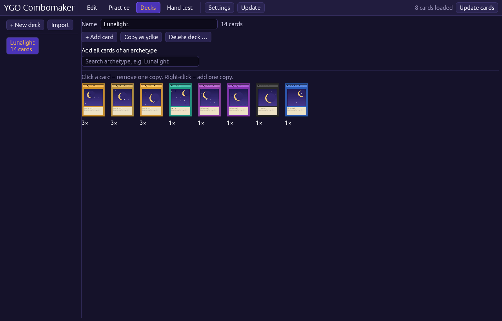

<p align="center">
  
</p>

<h1 align="center">YGO Combomaker</h1>

<p align="center">
  Yu-Gi-Oh!-Combos eintragen und auf einem Spielfeld üben – für Master Duel und TCG.<br>
  Native Desktop-App in Rust. Keine Anmeldung, kein Browser, kein Electron.
</p>

<p align="center">
  <a href="https://github.com/maniacmaik99/ygo-combomaker/releases/latest"></a>
  <a href="https://github.com/maniacmaik99/ygo-combomaker/actions/workflows/ci.yml"></a>
  
</p>

<p align="center"><em>Desktop app to record and practice Yu-Gi-Oh! combos. Interface in English, German, French, Italian, Spanish and Portuguese.</em></p>



| Üben | Handtest | Decklisten |
|---|---|---|
|  |  |  |

Die Bildschirmfotos zeigen Platzhalterkarten. In der App erscheinen die echten Kartenbilder.

## Was die App kann

- **Combo eintragen:** Starthand wählen und die Combo auf dem Spielfeld spielen. Jeder Zug wird gespeichert.
- **Üben:** Die Combo Zug für Zug nachspielen. Die App zeigt nach jedem Zug, ob er richtig war.
- **Handtest:** Starthände aus einer Deckliste ziehen, frei ausspielen und 1000 Hände simulieren.
- **Decklisten:** aus einem Archetyp füllen oder importieren (ydke-Link, YDK-Datei, Kartenliste).
- **Bannliste:** Master Duel, TCG oder OCG wählbar. Verbotene und limitierte Karten sind markiert, Decklisten werden geprüft. Die Listen werden bei jedem Start neu geladen.
- **Combo als Text (experimentell):** Combo in Kurzschrift tippen oder einfügen, die App sucht die Karten selbst.
- **Update-Knopf:** Die App aktualisiert sich selbst über GitHub Releases.

## Installieren

Alle Dateien liegen unter [Releases](https://github.com/maniacmaik99/ygo-combomaker/releases/latest). Es gibt sie nur für 64-Bit-Rechner (x86_64).

### Linux: alle Distributionen (Arch, Debian, Fedora, …)

1 Befehl im Terminal. Er installiert die App nur für deinen Benutzer, ohne root, mit Eintrag im Startmenü:

```sh
curl -fsSL https://raw.githubusercontent.com/maniacmaik99/ygo-combomaker/main/install.sh | sh
```

Deinstallieren:

```sh
curl -fsSL https://raw.githubusercontent.com/maniacmaik99/ygo-combomaker/main/install.sh | sh -s -- --uninstall
```

Falls der Befehl `ygo-combomaker` danach im Terminal nicht gefunden wird: `~/.local/bin` fehlt im `PATH`. Der Eintrag im Startmenü funktioniert trotzdem.

### Debian, Ubuntu, Linux Mint

```sh
sudo apt install ./ygo-combomaker-linux-amd64.deb
```

### Fedora, openSUSE

```sh
sudo dnf install ./ygo-combomaker-linux-x86_64.rpm
```

### Linux ohne Installation

`ygo-combomaker-linux-x86_64` herunterladen, dann:

```sh
chmod +x ygo-combomaker-linux-x86_64
./ygo-combomaker-linux-x86_64
```

### Windows

`ygo-combomaker-windows-x86_64.exe` herunterladen und starten.

### Hinweis zum Update-Knopf

Der Update-Knopf ersetzt die Programmdatei. Das geht nur, wenn dein Benutzer die Datei ändern darf. Bei der Installation mit `install.sh`, ohne Installation und unter Windows funktioniert er. Nach der Installation als `.deb` oder `.rpm` liegt das Programm in `/usr/bin`; dann zeigt die App einen Hinweis, und du installierst die neue Paketdatei von der Release-Seite.

## Combo als Text schreiben (experimentell)

Statt die Combo auf dem Spielfeld zu klicken, kannst du sie als Text schreiben und über „Importieren“ einfügen. Die Funktion ist experimentell: Prüfe das Ergebnis nach dem Import. Die App zeigt nach dem Import, welche Kartennamen sie ergänzt hat, welche Karten sie nicht gefunden hat und welche Zeilen Probleme machen. Dieselbe Anleitung steht in der App im Fenster „Combo importieren“ zum Aufklappen.

```text
# Gold Leo combo
deck: Lunalight
hand: Gold Leo + any

ns Gold Leo
eff Gold Leo > send Yellow Marten

eff Yellow Marten > search Kaleido Chick // from the graveyard
cl2 Kaleido Chick > send Wolf
scale Wolf [pl]
fusion Liger Dancer [emz]

end: Liger Dancer
```

Regeln:

1. `# Titel` beginnt eine Combo. Ein Text darf mehrere Combos enthalten.
2. Optionale Zeilen: `deck:`, `author:`, `hand:` (Starthand), `end:` (Endboard), `through:` (Handtraps, durch die die Combo spielt), `note:`. Karten mit `+` trennen. `any` steht für eine beliebige Karte.
3. Jede andere Zeile ist ein Zug: Schlüsselwort, dann Kartenname. Mehrere Züge in einer Zeile mit ` > ` trennen.
4. Eine leere Zeile beginnt einen neuen Schritt.
5. `[zone]` am Ende eines Zugs wählt eine Zone. `// Text` fügt dem Zug eine Notiz hinzu.
6. Ohne `end:` nimmt die App die Karten, die am Ende auf dem Feld liegen, als Endboard.
7. In `hand:` trennt `|` Alternativen für eine Karte: `hand: Gold Leo + Foolish Burial | Masquerade`.
8. `[if Karte]` am Zeilenanfang: Die Züge dieser Zeile werden nur gespielt, wenn diese Karte in der Starthand ist (Hauptkarte oder Alternative). Beispiel: `[if Masquerade] act Masquerade > send Yellow Marten`.

Kartennamen dürfen gekürzt sein (`Gold Leo` statt `Lunalight Gold Leo`). Bei mehreren Treffern gewinnt die Karte aus der Deckliste oder dem Archetyp, der bei `deck:` steht. Kleine Tippfehler werden korrigiert.

| Schlüsselwort | Aktion |
|---|---|
| `ns`, `normal` | Normalbeschwörung |
| `ss`, `special` | Spezialbeschwörung |
| `ts` | Tributbeschwörung |
| `set` | Setzen (Monster verdeckt; Zauber/Falle setzen) |
| `flip` | Flippbeschwörung |
| `fusion`, `ritual`, `synchro`, `xyz`, `pendulum`, `link` | Beschwörung dieser Art |
| `act`, `activate`, `eff`, `effect` | Effekt aktivieren |
| `cl1`, `cl2`, … | Kettenglied mit dieser Nummer |
| `scale` | in die Pendelzone legen |
| `setst`, `place`, `equip` | Zauber/Falle setzen, offen auf das Feld legen, ausrüsten |
| `tribute`, `mat`, `attach`, `detach`, `discard` | Tribut, Material, Xyz-Material an-/abhängen, abwerfen |
| `search`, `add` | Suchen (auf die Hand; mit `[gy]` auf den Friedhof) |
| `draw`, `send`, `mill`, `banish`, `destroy`, `bounce` | Ziehen, auf den Friedhof, Verbannen, Zerstören, zurück auf die Hand |
| `gytohand`, `gytodeck`, `banishedtohand`, `banishedtogy` | Friedhof → Hand/Deck, verbannt → Hand/Friedhof |
| `todeck`, `toextra` | zurück ins Deck / Extra Deck |
| `reveal`, `negate`, `target`, `pos` | Aufdecken, Annullieren, Ziel wählen, Kampfposition ändern |

Zonen: `[mz]` Monsterzone, `[emz]` Extra-Monsterzone, `[st]` Zauber-/Fallenzone, `[pl]` / `[pr]` Pendelzone links / rechts, `[field]` Feldzauberzone, `[hand]`, `[gy]`.

„Als Text kopieren“ in den Combo-Details schreibt eine vorhandene Combo in diesem Format.

## Datenquelle

Kartennamen, Kartentexte und Bilder kommen von der freien **YGOPRODeck-API** (https://ygoprodeck.com/api-guide/).

- Beim ersten Start lädt die App die komplette Kartenliste (englisch + deutsche Namen) und speichert sie lokal.
- Bilder werden erst geladen, wenn eine Karte angezeigt wird, und danach lokal gespeichert. Jedes Bild wird nur einmal heruntergeladen.
- Normalerweise lädt die App das kleine Kartenbild. Wird eine Karte breiter als etwa 176 Pixel angezeigt, lädt sie zusätzlich einmal das große Bild (Ordner `images/large`), damit die Karte scharf bleibt.
- Höchstens 20 Bild-Downloads pro Sekunde (Limit der API).
- „Karten aktualisieren“ prüft online die Datenbank-Version und lädt nur bei Änderungen neu.

Die Listen der verbotenen und limitierten Karten (Master Duel, TCG, OCG) kommen vom Projekt **YAML Yugi** (https://github.com/DawnbrandBots/yaml-yugi-limit-regulation). Es veröffentlicht die aktuellen Listen als kleine JSON-Dateien und aktualisiert sie täglich. Die App lädt sie bei jedem Start und speichert sie lokal, damit sie auch ohne Internet verfügbar sind. Die TCG-Liste dort stammt von der europäischen Konami-Seite.

Master Duel Meta hat keine offizielle, dokumentierte API. Deshalb nutzt die App deren Daten nicht.

Kartentexte und -bilder: © Konami / 4K Media. Diese App ist nicht mit Konami oder YGOPRODeck verbunden.

## Updates

Der Knopf „Update“ oben in der App sucht auf GitHub nach einem neueren Release. Wenn es eins gibt, lädt die App die passende Datei herunter, ersetzt sich selbst und startet neu. Optional prüft die App das auch beim Start (Einstellungen).

## Neue Version veröffentlichen (2 Schritte)

1. In `Cargo.toml` die Version erhöhen, z. B. `0.2.0`.
2. Committen und auf `main` pushen.

GitHub Actions merkt, dass es für diese Version noch kein Release gibt, baut Linux- und Windows-Version und legt das Release `v0.2.0` an (Datei `.github/workflows/release.yml`). Das dauert etwa 13 Minuten.

## Selbst bauen

Voraussetzung: Rust (https://rustup.rs).

```bash
cargo run --release
```

Das fertige Programm liegt danach unter `target/release/ygo-combomaker` (Windows: `ygo-combomaker.exe`).

## Speicherorte

| Was | Linux | Windows |
|---|---|---|
| Combos, Einstellungen | `~/.local/share/ygo-combomaker/` | `%APPDATA%\ygo-combomaker\data\` |
| Kartendatenbank, Bilder | `~/.cache/ygo-combomaker/` | `%LOCALAPPDATA%\ygo-combomaker\cache\` |

## Funktionen (Stand 0.11)

- **Sprachen:** Englisch, Deutsch, Französisch, Italienisch, Spanisch, Portugiesisch (Einstellungen → Sprache). Kartennamen optional in der gewählten Sprache (außer Spanisch, das bietet die Kartendatenbank nicht an).
- **Bedienung wie im Spiel:** Karte anklicken → direkt an der Karte erscheint ein Menü mit den Aktionen, die an diesem Ort üblich sind (z. B. Hand: Normalbeschwörung, Spezialbeschwörung, Setzen, Effekt aktivieren). Oder die Karte mit der Maus auf eine Zone, den Friedhof, den Verbannt-Stapel oder die Hand ziehen. Deck und Extra Deck sind Stapel auf dem Feld. Esc oder Rechtsklick bricht ab, Strg+Z macht den letzten aufgenommenen Zug rückgängig. Optional wählt die App freie Zonen automatisch (Einstellungen).
- **Tipp beim Üben:** markiert die Karte des nächsten Zugs.
- **Handtest:** zieht eine zufällige Starthand aus einer Deckliste, zeigt, welche gespeicherten Combos damit spielbar sind, und simuliert 1000 Hände (Anteil der Hände, mit denen eine Combo spielbar ist). Als benötigt zählen nur die Karten der Starthand, die in den Schritten der Combo auch benutzt werden.
- **Alternative Starthände:** Unter jeder Karte der Starthand fügt „+ oder“ Karten hinzu, die diese Karte ersetzen können. Der Handtest zählt die Combo dann auch mit einer Alternative als spielbar. Beim Üben wählst du oben die Starthand; die gewählte Karte ersetzt die Hauptkarte in allen Schritten.
- **Alternative Züge:** Im Listenmodus einen Zug anklicken und bei „Diesen Zug nur spielen mit:“ eine Karte der Starthand wählen. Der Zug gehört dann nur zu der Variante mit dieser Karte. Unter dem Zug steht „nur mit …“.
- **Bannliste:** In den Einstellungen Master Duel, TCG oder OCG wählen. Karten tragen oben links eine Marke: rotes Verbotszeichen = verboten, orange 1 = limitiert, gelbe 2 = halb-limitiert. Die Decklisten-Ansicht meldet Karten mit zu vielen Kopien und zeigt das Datum der Liste.
- **Suche in der Combo-Liste.**
- **Freies Spiel im Handtest:** Die gezogene Hand lässt sich auf einem Spielfeld frei ausspielen (ohne Prüfung, mit Rückgängig).
- **Kartengrößen:** getrennte Regler für die Kartengröße in Listen (bis 280) und im Fenster „Karte suchen“ (bis 220).
- **Combo eintragen auf dem Spielfeld:** Starthand festlegen, dann die Combo spielen: Karte anklicken → Aktion wählen → falls nötig Zielzone anklicken. Jeder Zug wird gespeichert. „Neuer Schritt“ trennt Schritte, „Letzten Zug rückgängig“, „Feld als Endboard übernehmen“.
- **Combo eintragen als Liste:** alle Bereiche (Starthand, Endboard, Handtraps, benötigte Karten, Schritte) Karte für Karte bearbeiten.
- **Spielfeld (Aufbau wie Master Rule 5):** 2 Extra-Monsterzonen über Monsterzone 2 und 4; Feldzauberzone, 5 Monsterzonen, Friedhof; Extra Deck, 5 Zauber-/Fallenzonen (die beiden äußeren sind zugleich die Pendelzonen), Deck; Verbannt über dem Friedhof; Hand darunter. Das Feld passt seine Größe an das Fenster an und ist zentriert. Xyz-Material erscheint als Stapel, sobald es welches gibt.
- **Aktionen (38):** Effekt aktivieren, Kettenglied (frei wählbare Nummer), in die Pendelzone legen, Zauber/Falle setzen, offen auf das Feld legen, Ausrüsten; Normal-, Tribut-, Flipp-, Spezial-, Fusions-, Ritual-, Synchro-, Xyz-, Pendel- und Linkbeschwörung, Monster verdeckt setzen; Tribut, Material, Xyz-Material an-/abhängen, Abwerfen; Suchen (auf Hand oder Friedhof), Ziehen, Friedhof, Verbannen, Zerstören, zurück auf die Hand, Friedhof → Hand/Deck, verbannt → Hand/Friedhof, zurück ins Deck/Extra Deck, Aufdecken; Annullieren, Ziel wählen, Kampfposition ändern.
- **Üben auf dem Spielfeld:** Die Combo Zug für Zug nachspielen. Nach jedem Zug: richtig oder falsch. „Lösung zeigen“ spielt den nächsten Zug vor. Ergebnis in Prozent, bestes Ergebnis wird gespeichert.
- **Decklisten:** aus einem Archetyp füllen oder importieren (ydke-Link, YDK-Datei, Kartenliste). Eine Combo kann mit einer Deckliste verknüpft werden; deren Karten stehen beim Hinzufügen ganz oben.
- **Teilen:** Combo als Text in die Zwischenablage kopieren, mit „Importieren“ wieder einfügen.

## Aufbau des Codes

| Datei | Inhalt |
|---|---|
| `src/model.rs` | Datenmodell (Combo, Schritt, Karte, Aktion, Zone) |
| `src/cards.rs` | Kartendatenbank, YGOPRODeck-API, Suche |
| `src/images.rs` | Bilder laden und zwischenspeichern (Hintergrund-Threads) |
| `src/decks.rs` | Decklisten importieren (ydke, YDK, Kartenliste) |
| `src/storage.rs` | Speicherorte, Laden/Speichern, Teilen |
| `src/banlist.rs` | Bannlisten (Master Duel, TCG, OCG) laden und Karten zuordnen |
| `src/board.rs` | Spielfeld-Logik: Zonen, Züge, Ziel jeder Aktion |
| `src/practice.rs` | Logik des Übungsmodus (Züge prüfen) |
| `src/combotext.rs` | Textformat für Combos (experimentell): Lesen und Schreiben |
| `src/updater.rs` | Update über GitHub Releases |
| `src/i18n/` | Übersetzungen (eine Datei pro Sprache) |
| `src/theme.rs` | Farben und Stil der Oberfläche |
| `src/app/` | Oberfläche (Editor, Spielfeld, Üben, Decks, Handtest, Kartensuche) |
| `assets/` | Logo (`make_icon.py` erzeugt es neu), Desktop-Datei für Linux |

Tests: `cargo test`
